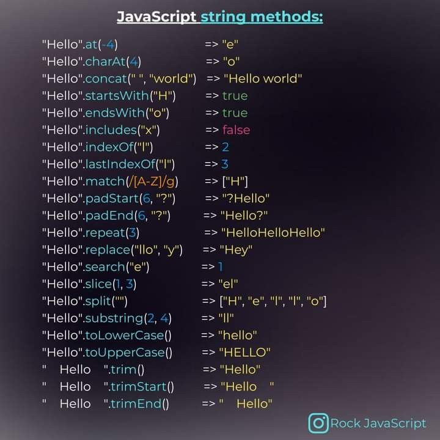

# JS Inbuilt String Methods

Check here for [MDN Resources](https://developer.mozilla.org/en-US/docs/Web/JavaScript/Reference/Global_Objects/String) for more detailed documentation

Please feel free to go through this below for faster understanding.


Image credits to: [Mayur Patil](https://www.linkedin.com/in/mayurpatil77/) | [Source](https://www.linkedin.com/pulse/javascript-string-methods-cheat-sheet-mayur-patil/?trackingId=b5BHyPkSRvqy%2FzZeEuwQmQ%3D%3D)

JavaScript provides several built-in methods to work with strings. These methods allow you to manipulate, inspect, and transform strings in various ways. Here are some of the most commonly used string methods along with example code for each:

### `length`

- **Description**: Returns the number of characters in a string.
- **Example**:
  ```javascript
  const str = "Hello, World!";
  console.log(str.length); // Output: 13
  ```

### `toUpperCase()` and `toLowerCase()`

- **Description**: Convert a string to uppercase or lowercase, respectively.
- **Example**:
  ```javascript
  const str = "Hello, World!";
  console.log(str.toUpperCase()); // Output: "HELLO, WORLD!"
  console.log(str.toLowerCase()); // Output: "hello, world!"
  ```

### `trim()`

- **Description**: Removes whitespace from both ends of a string.
- **Example**:
  ```javascript
  const str = "  Hello, World!  ";
  console.log(str.trim()); // Output: "Hello, World!"
  ```

### `split()`

- **Description**: Splits a string into an array based on a specified separator.
- **Example**:
  ```javascript
  const str = "apple,banana,orange";
  const fruits = str.split(",");
  console.log(fruits); // Output: ["apple", "banana", "orange"]
  ```

### `includes()`

- **Description**: Checks if a string contains a specified substring.
- **Example**:
  ```javascript
  const str = "Hello, World!";
  console.log(str.includes("World")); // Output: true
  console.log(str.includes("world")); // Output: false
  ```

### `replace()`

- **Description**: Replaces a specified substring with another substring.
- **Example**:
  ```javascript
  const str = "Hello, World!";
  const newStr = str.replace("World", "JavaScript");
  console.log(newStr); // Output: "Hello, JavaScript!"
  ```

### `indexOf()`

- **Description**: Returns the index of the first occurrence of a specified substring.
- **Example**:
  ```javascript
  const str = "Hello, World!";
  console.log(str.indexOf("World")); // Output: 7
  console.log(str.indexOf("world")); // Output: -1 (not found)
  ```

### `substring()` and `substr()`

- **Description**: Extracts a substring from a string.
- **Example**:
  ```javascript
  const str = "Hello, World!";
  console.log(str.substring(7, 12)); // Output: "World"
  console.log(str.substr(7, 5)); // Output: "World"
  ```

These are just a few of the string methods available in JavaScript. There are many more methods and functions you can use to manipulate strings as needed.
