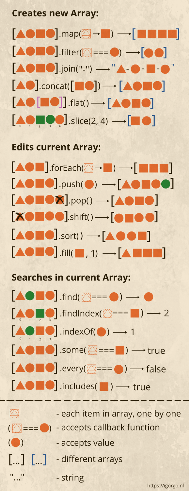

# JS Inbuilt Array Methods

Check here for [MDN Resources](https://developer.mozilla.org/en-US/docs/Web/JavaScript/Reference/Global_Objects/Array) for more detailed documentation

Please feel free to go through this below for faster understanding.


Image credits to: [Igor Gonchar](https://www.linkedin.com/in/igor-gonchar/) | [Source](https://www.linkedin.com/pulse/javascript-array-methods-cheatsheet-igor-gonchar/)

JavaScript provides several built-in methods for working with arrays. These methods allow you to manipulate arrays, transform their contents, and perform various operations. Here are some of the most commonly used array methods along with example code for each:

### `push()`, `pop()`, `shift()`, and `unshift()`

- **Description**: Methods for adding and removing elements from the beginning or end of an array.
- **Example**:

  ```javascript
  const arr = [1, 2, 3];

  arr.push(4); // Adds 4 to the end of the array
  console.log(arr); // Output: [1, 2, 3, 4]

  arr.pop(); // Removes the last element (4)
  console.log(arr); // Output: [1, 2, 3]

  arr.unshift(0); // Adds 0 to the beginning of the array
  console.log(arr); // Output: [0, 1, 2, 3]

  arr.shift(); // Removes the first element (0)
  console.log(arr); // Output: [1, 2, 3]
  ```

### `slice()`

- **Description**: Returns a shallow copy of a portion of an array.
- **Example**:
  ```javascript
  const arr = [1, 2, 3, 4, 5];
  const newArr = arr.slice(1, 4); // Slices from index 1 to index 4 (exclusive)
  console.log(newArr); // Output: [2, 3, 4]
  ```

### `splice()`

- **Description**: Adds or removes elements from an array at a specific index.
- **Example**:

  ```javascript
  const arr = [1, 2, 3, 4, 5];
  arr.splice(2, 1); // Removes 1 element at index 2
  console.log(arr); // Output: [1, 2, 4, 5]

  arr.splice(2, 0, 3); // Adds 3 at index 2 without removing any elements
  console.log(arr); // Output: [1, 2, 3, 4, 5]
  ```

### `map()`

- **Description**: Transforms each element in an array and returns a new array.
- **Example**:
  ```javascript
  const arr = [1, 2, 3, 4, 5];
  const squared = arr.map((x) => x * x);
  console.log(squared); // Output: [1, 4, 9, 16, 25]
  ```

### `filter()`

- **Description**: Returns a new array containing only elements that pass a provided test.
- **Example**:
  ```javascript
  const arr = [1, 2, 3, 4, 5];
  const even = arr.filter((x) => x % 2 === 0);
  console.log(even); // Output: [2, 4]
  ```

### `reduce()`

- **Description**: Applies a function against an accumulator and each element in the array to reduce it to a single value.
- **Example**:
  ```javascript
  const arr = [1, 2, 3, 4, 5];
  const sum = arr.reduce((acc, curr) => acc + curr, 0);
  console.log(sum); // Output: 15
  ```

### `sort()`

- **Description**: Sorts the elements of an array according to a provided function (or default lexicographical order).
- **Example**:

  ```javascript
  const arr = [3, 1, 4, 2, 5];
  arr.sort(); // Sorts in ascending order
  console.log(arr); // Output: [1, 2, 3, 4, 5]

  // Sort based on a custom function
  const descSort = arr.sort((a, b) => b - a);
  console.log(descSort); // Output: [5, 4, 3, 2, 1]
  ```

These are just a few of the most common array methods in JavaScript. There are many other methods available for working with arrays efficiently.
