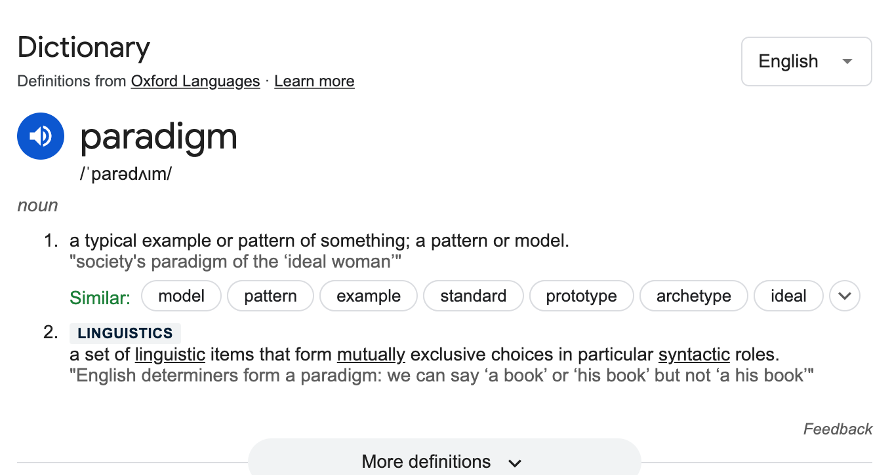

# Object Oriented Programming

Object-oriented programming (OOP) is a programming `paradigm` based on the concept of objects, which are instances of classes that encapsulate data and behavior. In OOP, objects interact with each other through methods and properties, allowing developers to model real-world entities and relationships in code. OOP is a widely used programming paradigm that provides various benefits, including modularity, reusability, and easier maintenance of code.



JavaScript supports object-oriented programming (OOP), which is a programming paradigm based on the concept of "objects." Objects are instances of classes, which are templates or blueprints defining the properties and behaviors of objects. JavaScript's approach to OOP is prototype-based, although with the introduction of ES6, it also supports class-based OOP syntax.

Here's an explanation of key concepts in JavaScript's object-oriented programming:

1. **Objects**: Objects are the fundamental building blocks in JavaScript. They are collections of key-value pairs where the keys are strings (properties) and the values can be any data type (including other objects, functions, and primitive types).

   ```javascript
   const person = {
     name: "Alice",
     age: 30,
     greet() {
       console.log(`Hello, my name is ${this.name} and I am ${this.age} years old.`);
     },
   };

   console.log(person.name); // Accessing property
   person.greet(); // Calling method
   ```

2. **Classes**: JavaScript classes were introduced in ES6 as syntactical sugar over JavaScript's existing prototype-based inheritance. They provide a cleaner and more familiar syntax for creating objects and defining their properties and methods.

   ```javascript
   class Person {
     constructor(name, age) {
       this.name = name;
       this.age = age;
     }

     greet() {
       console.log(`Hello, my name is ${this.name} and I am ${this.age} years old.`);
     }
   }

   const person = new Person("Alice", 30);
   person.greet();
   ```

3. **Inheritance**: JavaScript supports inheritance, allowing one class (the subclass) to inherit properties and methods from another class (the superclass). This allows for code reuse and the creation of hierarchical relationships between classes.

   ```javascript
   class Animal {
     constructor(name) {
       this.name = name;
     }

     speak() {
       console.log(`${this.name} makes a sound.`);
     }
   }

   class Dog extends Animal {
     speak() {
       console.log(`${this.name} barks.`);
     }
   }

   const dog = new Dog("Buddy");
   dog.speak(); // Output: Buddy barks.
   ```

4. **Encapsulation**: Encapsulation is the bundling of data and methods that operate on the data into a single unit (an object). JavaScript objects encapsulate data and behavior, allowing for better organization and abstraction.

5. **Polymorphism**: Polymorphism allows objects of different classes to be treated as objects of a common superclass. In JavaScript, polymorphism is achieved through method overriding, where subclasses provide their own implementation of methods inherited from a superclass.

6. **Abstraction**: Abstraction is the process of hiding the implementation details and showing only the essential features of an object. JavaScript objects and classes can use abstraction to expose only the necessary properties and methods to the outside world while hiding the internal implementation details.

Overall, JavaScript's object-oriented programming capabilities enable developers to create modular, reusable, and maintainable code by organizing data and behavior into objects and classes. These features facilitate code organization, reuse, and extensibility, making JavaScript suitable for building complex and scalable applications.
