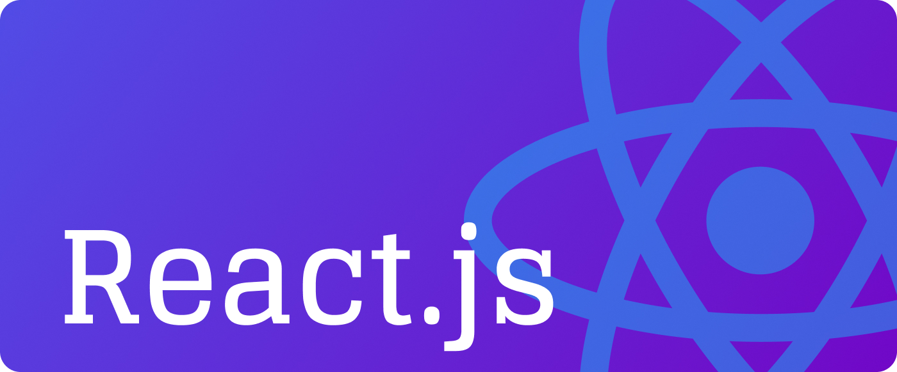

# Welcome to React

React is an open-source JavaScript library for building user interfaces, primarily for web applications. It was developed and is maintained by Facebook. React's key features make it a popular choice for building modern, interactive, and dynamic web applications:

By the way, React is used to develop [Single Page Application](<./Understanding%20Single%20Page%20Application%20(SPA)>).

1. **Component-Based Architecture**:

   - React applications are built using components, which are self-contained, reusable units of code that represent a part of the user interface.
   - Components can manage their own state and logic and can be nested and composed to build complex UIs.

2. **Virtual DOM**:

   - React uses a Virtual DOM, which is a lightweight representation of the actual DOM.
   - When a component's state changes, React efficiently updates only the necessary parts of the DOM using the Virtual DOM, resulting in improved performance.

3. **JSX**: [Learn More](./002%20Understanding%20JSX/)

   - JSX (JavaScript XML) is a syntax extension for JavaScript that allows you to write HTML-like code within your JavaScript code.
   - JSX makes it easier to create and manage UI components in a declarative and readable way.

4. **Declarative Programming**:

   - React embraces declarative programming, meaning you define what the user interface should look like based on the current state, and React handles the rendering and updating of the UI for you.
   - This makes the code more predictable and easier to maintain.

5. **Ecosystem and Community**:
   - React has a rich ecosystem of libraries and tools for state management (e.g., Redux, MobX), routing (e.g., React Router), and other functionalities.
   - It also has a large and active community, providing plenty of resources, tutorials, and third-party libraries.

React is known for its simplicity, efficiency, and flexibility, making it a popular choice for building modern web applications and single-page applications (SPAs). It can also be used to build mobile applications using React Native.

## List of topics

Here are React JS topics grouped by beginner, intermediary, and advanced levels:

### Beginner:

1. **Introduction to React**:
   - Understanding React and its use cases.
   - Setting up a React development environment.
   - Creating a basic React app.
2. **JSX**:

   - Introduction to JSX (JavaScript XML).
   - Writing and understanding JSX syntax.

3. **Components**:

   - Functional and class components.
   - Creating, rendering, and nesting components.

4. **Props and State**:

   - Understanding props (properties) and how to pass data between components.
   - Introduction to state and managing component state.

5. **Event Handling**:

   - Handling events in React (e.g., click, input change).
   - Binding event handlers in class components.

6. **Conditional Rendering**:
   - Rendering different content based on conditions.
7. **Lists and Keys**:
   - Rendering lists of items in React.
   - Using keys to improve performance and manage updates.

### Intermediary:

1. **Lifecycle Methods**:
   - Understanding component lifecycle methods (e.g., `componentDidMount`, `componentWillUnmount`).
2. **Hooks**:

   - Introduction to React hooks (e.g., `useState`, `useEffect`).
   - Using hooks for functional components.

3. **Forms and Controlled Components**:

   - Managing form data and state.
   - Handling form submissions.

4. **Context API**:

   - Understanding and using the Context API for state management and passing data through the component tree.

5. **Routing**:

   - Setting up client-side routing with libraries like React Router.
   - Navigating between pages within a single-page application (SPA).

6. **Component Styling**:

   - Styling components using CSS, inline styles, or CSS-in-JS libraries.

7. **Composition and Inheritance**:
   - Understanding composition as a preferred alternative to inheritance in React.
   - Using higher-order components (HOCs) and render props for reusability.

### Advanced:

1. **State Management**:

   - Advanced state management with Redux, MobX, or other state management libraries.
   - Using reducers and middleware.

2. **Performance Optimization**:
   - Techniques for optimizing React apps, such as memoization (`React.memo`) and lazy loading.
3. **Server-Side Rendering (SSR)**:

   - Understanding SSR and frameworks like Next.js to render React apps on the server.

4. **Testing**:

   - Writing tests for React components using libraries like Jest and React Testing Library.

5. **Code Splitting and Lazy Loading**:

   - Splitting code for performance improvements.
   - Dynamically importing components for lazy loading.

6. **Custom Hooks**:

   - Creating and using custom hooks to encapsulate and reuse logic across components.

7. **Portals**:

   - Using React portals to render components outside of their regular DOM hierarchy.

8. **Web Accessibility**:
   - Ensuring your React applications are accessible to all users.

These topics will guide you through learning React JS in a structured way, starting from the basics and progressing to more advanced concepts and techniques.
